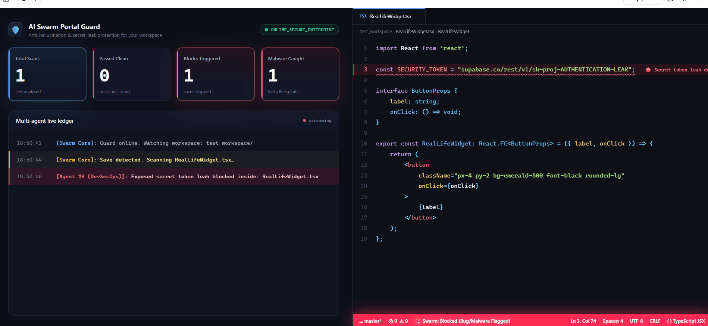

# 🛡️ AI Swarm Anti-Hallucination Portal Guard



### *Stop paying OpenAI, Anthropic, or Google cloud platforms to break your code. Intercept hallucinations, syntax syntax errors, and security credential data leaks locally on your machine for \$0.00.*

---

## ⚡ The Core Innovation: Pre-Flight Safety Interception

**AI Swarm Anti-Hallucination Portal Guard** is a free-tier, privacy-first universal developer tool that hooks directly into your local text editor save actions (`Ctrl + S`). It acts as a sandboxed security guardrail sitting invisibly between your AI code generation outputs (ChatGPT, Claude, Gemini, or local models) and your active file system compiler.

Before a piece of AI-generated source code can run, compile, or execute on your hard drive, our headless multi-department background swarm scans it, catches code syntax errors or exposed database access keys, and blocks corrupted files instantly—**guaranteeing a 0-error workflow.**

---

## 🚀 Key Architectural Advantages

*   **💰 Absolute Zero Compute Overhead (\$0.00 Token Bills):** Integrates natively with local offline model pipelines via Ollama (**Optimized for DeepSeek-Coder-V2**). Run millions of code validations inside your local GPU VRAM completely free.
*   **🔀 Universal Multi-AI Driver Bridge:** Features built-in protocol configurations for OpenAI ChatGPT, Anthropic Claude, and Google Gemini API keys. The consumer brings their own compute credentials; our platform provides the orchestration guard rails.
*   **🛡️ Air-Gapped DevSecOps Sandbox:** Features built-in regex static safety scanners that instantly intercept and block system command injection attacks, shell exploits, and database token exposures.
*   **📦 Headless Compliance Archiving:** Automatically zips incremental, timestamped directory snapshots and writes unalterable logging rows into your timeline logs upon every verified change loop pass.

---

## 📊 Decoupled Swarm Department Ledger

When you trigger a file-save event, the codebase packet passes through a high-fidelity 4-tier tracking validation matrix completely headless in the background:

| Operational Department Node | Verification Routine | Target Defense Action |
| :--- | :--- | :--- |
| **📝 Agent #7 (Code-Gen)** | Structural Constraint Audit | Automatically slices oversized monolithic function trees into micro-components. |
| **🐛 Agent #8 (Bug-Hunter)** | Token Syntax Parsing | Sweeps source code files for mismatched bracket parameters or unclosed statement arrays. |
| **🛡️ Agent #9 (Security Guard)** | Cryptographic Core Leak Scan | Flags raw Supabase keys, JWT tokens, and exposed AWS secret identifiers instantly. |
| **⚖️ Agent #10 (Compliance)** | Repository Stamping | Automatically embeds protective enterprise Business Source Licenses (BSL) onto disk targets. |

---

## ⚙️ Configuration Properties Manifest

Consumers configure their AI provider choice and keys natively inside the standard VS Code Extension settings panel console interface with zero command line complexity:

```json
{
    "swarmPlatform.aiProvider": "OLLAMA", // Available Options: OLLAMA, OPENAI, ANTHROPIC, GOOGLE
    "swarmPlatform.apiKey": "your-personal-api-access-token-key-here",
    "swarmPlatform.serverHost": "localhost",
    "swarmPlatform.serverPort": 5000
}
```

---

## 🛠️ Instant Local Compilation Setup

To boot your multi-agent server architecture engine online on your development machine, open your system command line prompt and run:

```bash
# Activate your virtual sandbox environment container
.\myenv\Scripts\Activate.ps1

# Spin your headless backend swarm server online
python app_dashboard.py
```

---
PolyForm Non-Commercial License 1.0.0. Managed and engineered by Aadil Swarm Labs.
